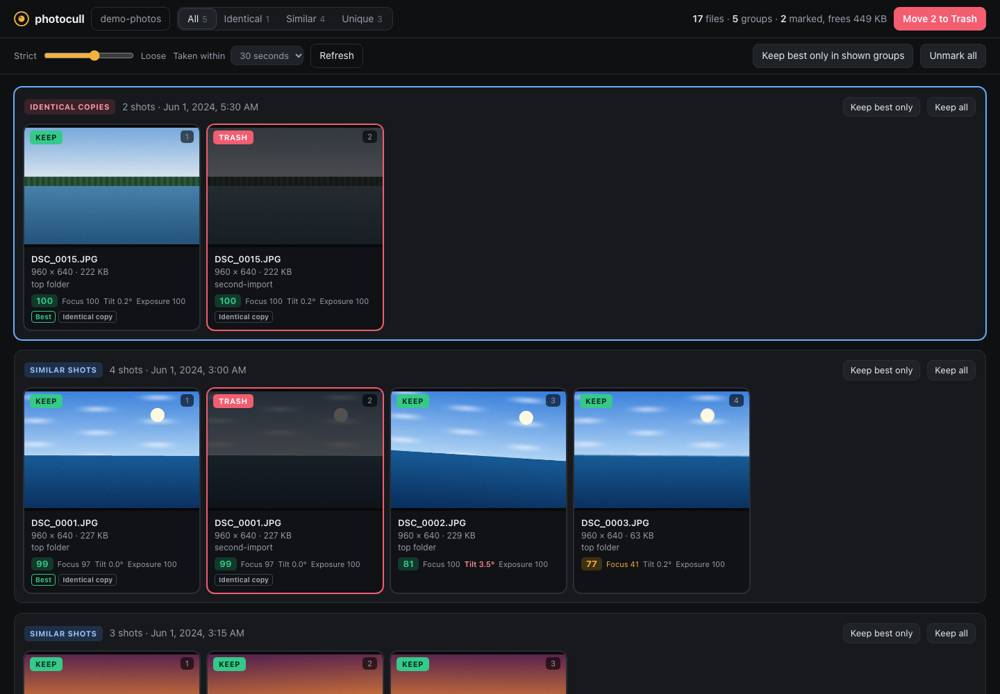
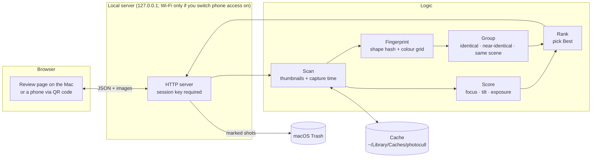

# photocull

Clear out duplicate and look-alike photos from a camera card or photo folder.
photocull groups the shots that show the same thing, scores each one for focus,
tilt and exposure, and lets you move the ones you don't want to the Trash in one
batch.

It runs entirely on your Mac: a small local web page, no account, no upload,
nothing to install. You can also review from your phone over Wi-Fi by scanning
a QR code.



> [!NOTE]
> photocull moves files to the Trash at your request. Review before you empty
> the Trash, and see [Privacy and safety](#privacy-and-safety) for the risks,
> in particular the [warning about phone access](#review-from-your-phone).

## Requirements

- macOS (uses the system's image tools and Vision framework)
- Xcode command line tools, which provide Python 3 and the Swift compiler:

  ```sh
  xcode-select --install
  ```

There are no Python packages to install.

## Quick start

```sh
git clone https://github.com/rexllz/photocull.git
cd photocull
./photocull.sh
```

Your browser opens the start page. Choose a folder (or paste its path), wait for
the scan, then review. Press `Ctrl+C` in the terminal to quit.


To skip the chooser, pass the folder: `./photocull.sh /path/to/photos`.

### Try it without your own photos

```sh
python3 demo/make_demo.py      # draws 17 synthetic "photos" into ./demo-photos
./photocull.sh demo-photos
```

The script only ever replaces a folder it created itself.

The demo set contains bursts where one frame is good, one is tilted and one is
out of focus, plus exact copies and a few one-off scenes. The screenshots in
this README were taken from it.

### What to expect on the first run

- The first scan reads every file: allow a few minutes for a few thousand
  photos. Later scans reuse a cache and only read new or changed files.
- The first run also compiles a small Swift helper (about 30 seconds, once).
- macOS may ask whether the terminal can access the folder or removable volume
  you picked. Allow it, or the scan finds nothing.

## Reviewing

Each group shows the shots side by side, best first.

- Click a shot to switch it between **KEEP** and **TRASH**.
- **Keep best only** / **Keep all** work per group, or on every group shown.
- **Not duplicates** on a group keeps all its shots and moves them to Unique,
  tagged "Not a duplicate", so the group stops coming back. This is kept in
  memory only: it lasts through Refresh and setting changes, and is forgotten
  when you open another folder or restart photocull. **Restore N skipped**
  in the toolbar puts the groups back.
- **View** opens a shot full size; `←` `→` flip between the shots of a group.
- **Move to Trash** moves everything marked to the macOS Trash. Nothing is
  deleted permanently until you empty the Trash.

Tabs:

| Tab | Shows |
|---|---|
| **All** | Every group |
| **Identical** | Byte-for-byte copies, e.g. a card imported twice. Extras start out marked for the Trash. |
| **Similar** | Look-alike shots: bursts, retakes, a subject that moved. Nothing is pre-marked. |
| **Unique** | Every shot with no look-alike, so you can see what was left out and trash any of those too. |
| **Videos** | Every video, to play, download or trash. Videos are never checked for duplicates or scored, and are never marked for the Trash unless you mark them. |
| **Every photo** | All photos, oldest first. **Review one by one** opens them full size: `←` `→` (or swipe) to move, `X` (or tap KEEP/TRASH) to mark, **Move N to Trash** without leaving the viewer, and on a phone **Download**. |


Finding a photo among thousands (the row under the toolbar):

- **Find**: type any part of a file or folder name, e.g. `0154` for
  `DSC_0154.JPG`.
- **Day**: show one day only; each day lists how many photos it has.
- **Order**: oldest or newest first, file name, largest first, lowest score
  first, most tilted first, or worst exposure first. In the group tabs, groups
  are ordered by the shot that fits best (e.g. their most tilted shot), and
  "largest first" puts the biggest groups first.
- **S / M / L**: picture size. **L** shows one large, sharper picture per row
  on a phone.

The tab counts always describe the whole folder; the number of matches shows
next to the size buttons. The top bar slides away while you scroll down and
comes back as soon as you scroll up. On the phone, the Wi-Fi warning can be
hidden with ✕ until the page is reloaded.

Controls:

- **Strict / Loose**: how alike two shots must look to be grouped.
- **Taken within**: how close in time shots must be to count as one burst.
- **Refresh**: pick up files added to the folder since the scan.

Keys: `J`/`K` next/previous group, `1`–`9` toggle a shot, `B` keep best only,
`A` keep all, `Space` full size, `X` toggle while full size, `Esc` close.

## Review from your phone


> [!WARNING]
> **Phone access is not encrypted.** While it is switched on, the page, its
> key and **the photos themselves** (thumbnails, full-size views and
> downloads) travel over your Wi-Fi as plain HTTP. On a network shared with
> people you don't know (public, office, hotel, some apartment-building Wi-Fi),
> someone capturing traffic could see those photos, or read the key and then
> **view, download or trash the photos in the open folder**. Only switch it on
> when you trust everyone on the Wi-Fi (or use your phone's own hotspot), and
> switch it off when you're done. It is off by default, and the page shows a
> warning bar on both the Mac and the phone while it is on.

You can review on a phone while the photos stay on the Mac:

1. On the Mac's review page, click **Phone** and confirm. macOS may ask to
   allow incoming connections; choose Allow.
2. Scan the QR code with the phone's camera. The same review page opens in the
   phone's browser, laid out for a small screen.
3. Tap a shot to mark it, tap **View** to see it full size (swipe to flip
   between shots, pinch to zoom), and use **Move to Trash** as on the Mac. Files
   are moved to the Trash on the Mac; nothing on the phone is touched.
4. Click **Phone: on** → **Turn off phone access** when you're done.

### Download originals to the phone

- **One photo:** tap **View**, then **Download** to save the original file, or
  **Original** to open it full size (on an iPhone, long-press it there to save
  it to Photos).
- **Several photos:** tap **↓ Select** on each shot you want, then
  **Download N** at the top. They arrive as one zip file, with the folder
  structure kept; on an iPhone it lands in the Files app, where you can unzip
  it and save the pictures to Photos.

For a RAW + JPEG pair the JPEG is the file sent. A batch holds up to 500
photos and is streamed as it is read, so it starts at once; keep the page open
until it finishes. A transfer that stalls for more than ten minutes (for
example, the phone left the Wi-Fi) is dropped, and you can simply start it
again.

Both devices must be on the same Wi-Fi, and the Mac must stay awake. Some
networks (guest, hotel, some shared building Wi-Fi) block devices from reaching
each other; phone access cannot work there.

### Videos

Video playback uses the browser's own player. A Mac or iPhone plays camera
HEVC (H.265) video; if a browser cannot play a file, use **Open in QuickTime**
on the Mac or **Download** on the phone. Videos stream from the Mac as they
play, so a long 4K clip needs a good Wi-Fi connection.

## Scores and the "Best" shot

Every shot in a group gets a score out of 100, with its three parts shown:

| Check | Weight | How it is measured |
|---|---|---|
| **Focus** | 40% | Edge sharpness (Tenengrad) inside the subject: the faces if there are any, otherwise the region that draws the eye. Shown relative to the sharpest shot in the group. With faces, Apple's face capture quality (blur, eyes, expression) is blended in. |
| **Level** | 35% | The tilt of the longest straight near-level edge (horizon, shoreline, railing), found with a Hough transform. "Tilt n/a" means there is no such line; the check is then left out of the score. |
| **Exposure** | 25% | Share of the frame blown to white or crushed to black, plus overall brightness. |

The best shot is listed first. A clearly over- or under-exposed shot is never
best while another is available; then the highest score wins; ties fall back to
having a RAW file, more pixels, a larger file, and a name without "copy".

The score is a starting suggestion, not a verdict. It cannot judge composition
or expression, and tilt in particular can be fooled by a slope or a receding
shoreline. Compare by eye before trashing similar shots.

## How it works



1. **Scan.** Walks the folder and uses `sips` (built into macOS) to make a
   small thumbnail of each photo and read its capture time. Because the system
   does the decoding, RAW formats macOS understands (such as Nikon `.NEF`) are
   read the same way as JPEGs.
2. **Fingerprint.** Each thumbnail is reduced to a 256-bit shape hash (where
   the picture gets brighter or darker) and a 4×4 grid of average colours.
3. **Score.** A Swift helper (`photocull/photoscore.swift`) measures focus,
   tilt and exposure once per photo using the Vision framework.
4. **Group.** Shots are grouped when:
   - their file contents are identical; or
   - shape and colour both match closely, whenever they were taken (resized or
     re-saved copies); or
   - they were taken moments apart and show the same scene: the colours sit in
     the same places even if the subject moved, or the shapes line up across a
     moderate exposure change.

   A shot joins a burst only if it resembles the burst's first shot as well as
   its latest, so a slowly changing sequence cannot chain unrelated pictures
   into one group.
5. **Rank.** Within each group the shots are ordered by score.
6. **Trash.** Marked files are moved to the Trash with the system's own Trash
   function, never deleted outright.

A RAW file and its same-named JPEG in one folder (`DSC_0001.NEF` +
`DSC_0001.JPG`) count as one shot and are kept or trashed together.

Layout:

```
photocull.sh                launcher
photocull/__main__.py       command line entry
photocull/index.py          scan, thumbnails, fingerprints, cache, scoring driver
photocull/photoscore.swift  focus / tilt / exposure measurements
photocull/grouping.py       shots, grouping rules, scores and ranking
photocull/server.py         local web server and actions
photocull/trash.py          move to Trash
photocull/web/index.html    the page
demo/make_demo.py           synthetic demo photos
tests/                      unit tests
```

## Privacy and safety

- **Nothing leaves your network.** There are no calls to the internet,
  analytics or third-party services, and the page loads no external scripts or
  fonts.
- **Local only by default.** The server listens on `127.0.0.1`, so other
  devices on your network cannot reach it.
- **Phone access is opt-in.** Only while you switch it on does the app also
  answer on your Wi-Fi address. The phone gets its own random key (in the QR
  code), which stops working the moment you switch phone access off. From the
  phone you can review, download and trash within the open folder only:
  choosing other folders stays on the Mac.
- **Phone access is not encrypted.** The connection is plain HTTP inside your
  network, so the photos you view or download travel in the clear. On Wi-Fi
  shared with people you don't know (public, office, some apartment-building
  networks), someone capturing traffic could see them, or read the key and
  then view, download or trash the photos in the open folder. Use phone access
  on Wi-Fi you trust and switch it off afterwards.
- **Session key.** The link printed at start-up contains a random key. Every
  request must carry it, so other users logged in to the same Mac cannot view
  your photos or trash anything. Treat the link like a password while the app
  is running; it stops working when you quit.
- **Browser hardening.** Changes need both the session cookie and a token only
  the page knows, requests addressed to any other host name are refused, and
  responses forbid framing and loading anything from other sites.
- **Trash, not delete.** Files go to the macOS Trash and can be restored until
  you empty it. On a camera card or external drive they go to that volume's
  own Trash and keep using its space until you empty the Trash with the volume
  connected.
- **Your photo folder is never written to.** Thumbnails, scores and the index
  live in `~/Library/Caches/photocull/`; delete that folder to wipe them.
- **Videos are only trashed when you mark them.** They are listed in their own
  tab but never grouped, scored or pre-marked.

### Reporting a security problem

Please open an issue on the repository, without including private details of
your own setup.

## Where data is stored

**On the Mac**, in `~/Library/Caches/photocull/` (delete the folder any time;
it is rebuilt as needed):

- a small thumbnail per photo or video (about 50 KB each) and the scan index;
- full-size previews (about 1 MB each), made only for photos you open full size
  or view at size L. They are capped at 500 MB, least recently viewed dropped
  first, and removed when their photo is trashed or no longer in the folder.

**On the phone**, nothing is kept unless you save it:

- Thumbnails and previews may sit in the browser's own temporary cache for up
  to an hour so scrolling back is quick. iOS clears that cache by itself; it
  never appears in Photos or Files. Closing the tab, or clearing website data
  in the browser's settings, removes it at once.
- Videos and full-size originals are streamed while you watch and are not
  cached by the browser.
- **Download** saves the original to the browser's downloads (Files ›
  Downloads on an iPhone, which may be in iCloud Drive). A zip of several
  photos lands there too: after you save the photos to Photos, delete the zip
  in Files, since it is a second copy.
- Long-press → **Save to Photos** puts a copy in your photo library; that is
  the only way anything reaches Photos.

## Limitations

- macOS only.
- Developed and checked mostly against camera JPEGs. RAW files rely on macOS
  decoding and have had little testing.
- Files larger than 4 MB are compared by size plus three 1 MB samples (start,
  middle, end) rather than every byte, to keep scanning fast.
- A retake with a very different exposure may not be grouped with its
  siblings, because grouping looks at colour.
- Very plain frames (dark or blank shots) can be grouped as similar.
- The score weights and thresholds are sensible defaults, not tuned on a large
  photo collection. They live at the top of `photocull/grouping.py`.

## Command line options

```
./photocull.sh [folder] [--port N] [--no-open]

--port N     port for the page (default 8777)
--no-open    don't open the browser; use the printed link
```

## Tests

```sh
python3 -m unittest discover -s tests
```

## Licence

MIT. See [LICENSE](LICENSE).
